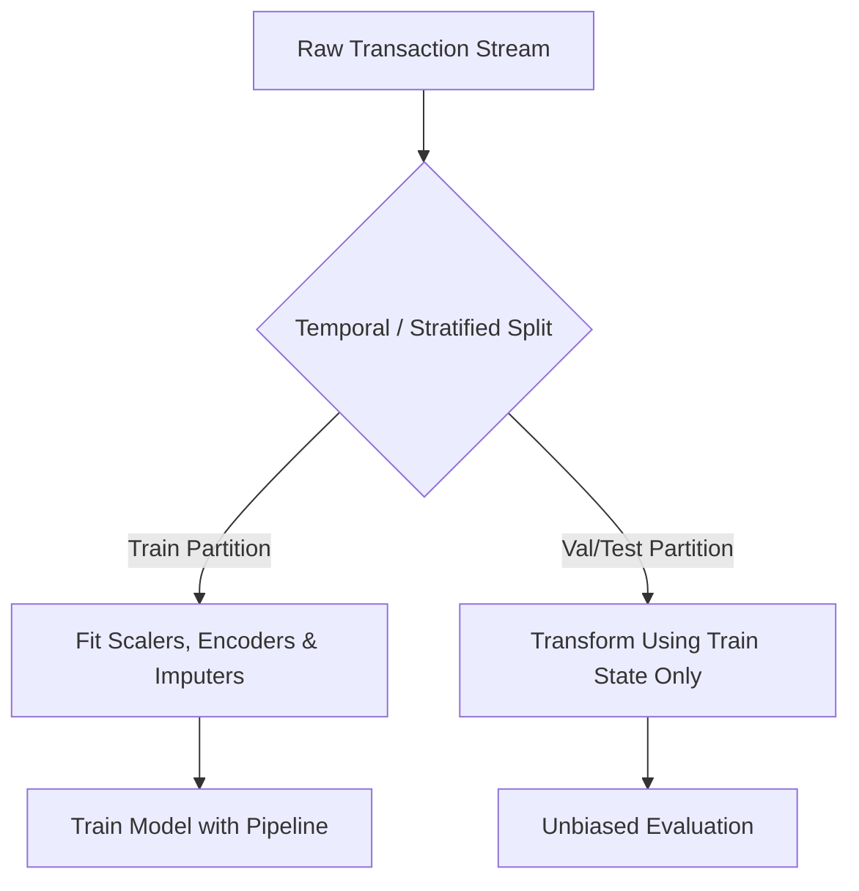
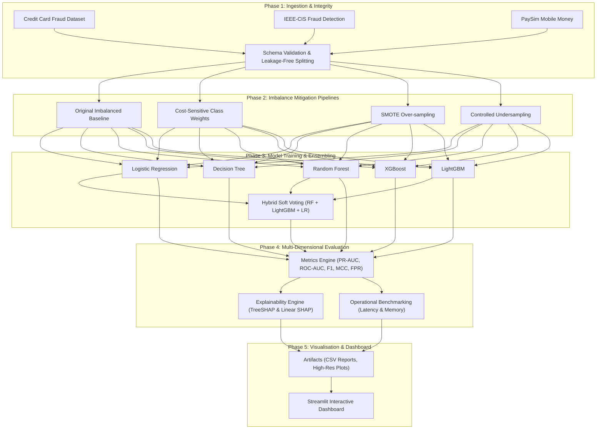

# Comparative Analysis of Fraud Detection Techniques in Digital Payment Systems

**Academic Level:** BTech Data Analytics and Visualisation Project  
**Status:** Phase 1 – Scaffolding & Objective Planning  
**Last Updated:** October 2026  

---

## 1. Executive Summary & Project Overview

Fraudulent transactions within digital payment ecosystems pose critical financial risks and operational challenges. Digital payment rails—ranging from credit card networks to mobile money transfer protocols—process billions of transactions daily. In these systems, fraudulent instances represent a minuscule fraction (often under 0.2%), creating an extreme class-imbalance setting where conventional classification paradigms and traditional accuracy metrics fail.

This project delivers an empirical, reproducible, and mathematically rigorous comparative analysis of fraud detection strategies across three heterogeneous financial datasets. By benchmarking linear, non-linear, and gradient-boosted architectures alongside a probability-based soft-voting hybrid ensemble, this investigation examines the interplay among:
1. Resampling and cost-sensitive class-imbalance mitigation techniques.
2. Distinct classifier inductive biases and calibration behaviors.
3. Feature architectures and data leakage vulnerabilities across diverse schemas.
4. Comprehensive multi-metric trade-offs, operational latency, and model explainability.

---

## 2. Research Objectives, Questions, and Methodology

### Objective 1: Comparative Analysis of Class-Imbalance Strategies

#### 1.1 Objective Statement
Investigate, implement, and benchmark four distinct strategies to address severe class imbalance across digital transaction datasets:
1. **Original Imbalanced Data (Baseline):** Training directly on the raw, natural class distribution without intervention.
2. **Cost-Sensitive Class Weighting:** Modifying the classifier loss function using balanced class weights inversely proportional to class frequencies:
   $$\text{weight}_c = \frac{N}{K \cdot N_c}$$
   where $N$ is total samples, $K$ is number of classes, and $N_c$ is sample count for class $c$. For boosted trees (XGBoost, LightGBM), the positive weight ratio is parameterized via:
   $$\text{scale\_pos\_weight} = \frac{N_{\text{negative}}}{N_{\text{positive}}} \approx 577.88$$
3. **Synthetic Minority Over-sampling Technique (SMOTE):** Generating synthetic fraud vectors along the feature-space line segments joining $k$-nearest minority neighbors:
   $$\mathbf{x}_{\text{new}} = \mathbf{x}_i + \lambda (\mathbf{x}_{zi} - \mathbf{x}_i), \quad \lambda \sim \mathcal{U}(0, 1)$$
4. **Controlled Undersampling (RandomUnderSampler):** Downsampling majority non-fraud transactions to achieve an empirically controlled ratio (e.g., 1:10 or 1:5 fraud-to-non-fraud) without discarding excessive structural variance.

#### 1.2 Credit Card Dataset Audit & Duplicate Analysis
The empirical validation of `data/raw/creditcard.csv` identified **284,807 transactions**, **31 attributes**, **492 fraudulent transactions (0.1727%)**, **284,315 legitimate transactions (99.8273%)**, and **1,081 duplicate rows (0.38%)** with zero missing values.

##### Structural Characterization of the 1,081 Duplicate Records:
- **Full-Row Identical Matches:** In pandas, `df.duplicated()` verifies identity across all 31 dimensions: `Time`, PCA components `V1` through `V28`, `Amount`, and `Class`.
- **Probabilistic Impossibility vs. Causal Ambiguity:** Because `V1`–`V28` are high-precision continuous floating-point variables derived from orthogonal principal component rotations, having 28 floating-point numbers plus `Time` and `Amount` identical across two distinct rows is mathematically impossible by random chance. However, **exact statistical duplication does not establish why the records were repeated** (e.g., transactional network retries, payment gateway re-submissions, batch reconciliation anomalies, or automated fraudster card-testing probes).
- **Trade-Off Analysis: Retaining vs. Removing Duplicates:**
  - *Implications of Retaining Duplicates:* If duplicate rows are preserved, identical records can be partitioned across train and test sets during cross-validation, causing **data leakage via memorization**. Furthermore, duplicate samples artificially inflate the loss gradient of repeated observations.
  - *Implications of Removing Duplicates:* Deduplication eliminates 1,081 redundant records (yielding 283,726 unique transactions: 283,253 legitimate and 473 fraud cases). Removing duplicates in the prepared data eliminates identical vector repetition while leaving `data/raw/creditcard.csv` untouched.
  - *Reproducible Preparation Design:* In accordance with data integrity standards, **the raw dataset file (`data/raw/creditcard.csv`) is never modified, deleted, or overwritten**. Data cleaning is executed via a deterministic function (`prepare_data()`) in `src/preprocessing/split.py` with an auditable toggle (`drop_duplicates: bool = True`) that logs both raw and prepared counts.
  - *Sensitivity Analysis Option:* The pipeline explicitly preserves `drop_duplicates=False` to enable a formal sensitivity experiment comparing model performance with duplicates retained versus removed, subject to computational feasibility.

#### 1.3 Predefined Resampling Ratio Grid for SMOTE and Undersampling
To evaluate the sensitivity of minority oversampling and majority undersampling across varying mitigation intensities, the pipeline defines multiple candidate resampling ratios (minority-to-majority count in training):
- **Ratio 1:20 ($\alpha = 0.05$):** Mild mitigation ($\approx 4.76\%$ fraud in training split).
- **Ratio 1:10 ($\alpha = 0.10$):** Moderate mitigation ($\approx 9.09\%$ fraud in training split).
- **Ratio 1:5 ($\alpha = 0.20$):** Strong mitigation ($\approx 16.67\%$ fraud in training split).
- **Ratio 1:2 ($\alpha = 0.50$):** Heavy mitigation ($\approx 33.33\%$ fraud in training split).
- **Ratio 1:1 ($\alpha = 1.00$):** Full class parity (50.00% fraud in training split).

*Computational Feasibility Guarantee:* Multi-ratio evaluation will be conducted systematically across baseline models, subject to computational feasibility, while ensuring validation and test sets remain strictly at their untouched natural distribution ($\approx 0.17\%$).

#### 1.4 Stratified Partitioning and Data Leakage Prevention
To ensure rigorous evaluation and prevent optimistic bias:
- **Partitioning Ratios:** The dataset is split into **60% Training**, **20% Validation**, and **20% Test** using a two-stage stratified partition with fixed seed `random_state=42`.
- **Natural Class Distribution Preservation:** Stratification ensures that the natural class imbalance ($\approx 0.1727\%$ fraud) is maintained identically across Train, Validation, and Test partitions.
- **Strict Partition Exclusivity:** Unit tests formally enforce zero index overlap:
  $$\text{Idx}_{\text{train}} \cap \text{Idx}_{\text{val}} = \emptyset, \quad \text{Idx}_{\text{train}} \cap \text{Idx}_{\text{test}} = \emptyset, \quad \text{Idx}_{\text{val}} \cap \text{Idx}_{\text{test}} = \emptyset$$
- **Leakage Prevention Protocols:**
  1. *Feature Scaling:* Scalers (`RobustScaler`, `StandardScaler`) are fitted strictly on `X_train` and merely transform `X_val` and `X_test`.
  2. *Resampling Scope:* SMOTE and RandomUnderSampler are wrapped exclusively inside `imblearn.pipeline.Pipeline`. Resampling is executed solely during `.fit()` on training folds; validation and test splits are never resampled.
  3. *Validation-Only Threshold Tuning:* Decision thresholds $\theta \in [0, 1]$ are optimized strictly on the validation set (`y_val`, `y_val_proba`) to maximize PR-AUC / F1-score / MCC. The test set remains completely frozen until final benchmark evaluation with the fixed threshold.

#### 1.5 Why Accuracy Alone is Inadequate for Digital Payment Fraud
In digital payment systems characterized by extreme class skew (e.g., 99.83% legitimate vs. 0.17% fraud), standard classification **Accuracy** is completely invalid as an optimization or evaluation objective:
$$\text{Accuracy} = \frac{TP + TN}{TP + TN + FP + FN}$$
- **The Accuracy Paradox:** A trivial "naive" classifier that predicts every transaction to be legitimate ($y=0$) achieves an **accuracy of 99.8273%**. However, its detection capability is completely zero ($Recall = 0\%$, $TP = 0$), allowing **100% of financial losses and fraudulent transactions to go undetected**.
- **Asymmetric Operational Costs:** In financial institutions, the cost of a False Negative (undetected stolen funds, chargeback fees, regulatory penalties) is orders of magnitude greater than a False Positive (a temporary fraud hold or secondary SMS/OTP challenge).
- **Metric Distortion:** Accuracy is overwhelmed by the massive True Negative volume ($TN \approx 284,000$), obscuring catastrophic failures in minority fraud detection.

#### 1.5 Multi-Metric Evaluation Framework
To evaluate models objectively and fairly, all experiments log:
1. **Precision-Recall AUC (PR-AUC / Average Precision):** The primary benchmark metric. Evaluates the trade-off across all probability thresholds without being distorted by true negatives.
2. **Recall (Sensitivity):** Fraction of actual fraud transactions intercepted ($\frac{TP}{TP + FN}$).
3. **Precision:** Fraction of flagged transactions that are genuine fraud ($\frac{TP}{TP + FP}$).
4. **F1-Score:** Harmonic mean of precision and recall ($2 \cdot \frac{P \cdot R}{P + R}$).
5. **Matthews Correlation Coefficient (MCC):** Balanced correlation coefficient considering all four quadrants of the confusion matrix:
   $$\text{MCC} = \frac{TP \cdot TN - FP \cdot FN}{\sqrt{(TP+FP)(TP+FN)(TN+FP)(TN+FN)}}$$
6. **False Positive Rate (FPR):** Operational customer friction metric ($\frac{FP}{FP + TN}$).
7. **ROC-AUC:** Diagnostic reference metric measured alongside PR-AUC to illustrate skew-induced metric inflation.
8. **Confusion Matrix:** Full contingency table providing raw counts for financial cost modeling.

#### 1.6 Fair Comparison Protocol
To guarantee complete scientific fairness and reproducibility:
- Every combination of imbalance strategy (4) and baseline classifier (5) is trained on the exact same `X_train` split.
- All models evaluate on the exact same untouched `X_val` and `X_test` partitions.
- Random seeds are fixed at `random_state=42` across all splits, resampling algorithms, and estimators.
- **Zero A Priori Assumptions:** No claims regarding the superiority of SMOTE, class weighting, or undersampling will be made prior to empirical logging.

#### 1.7 Deliverables & Completion Criteria
- Automated imbalance pipelines wrapped in scikit-learn/imbalanced-learn pipelines.
- Comparative metric table (PR-AUC, ROC-AUC, Recall, Precision, F1, MCC, FPR) per imbalance strategy across each baseline model.
- Distributional diagnostic plots (PR curves, ROC curves, confusion matrices).

---

### Objective 2: Establishing Baseline Fraud-Detection Architectures

#### 2.1 Objective Statement
Implement, tune, and evaluate five diverse baseline classification architectures spanning linear, decision-tree, bagged ensemble, and gradient-boosted paradigms:
1. **Logistic Regression (L2-regularized):** Serves as the linear benchmark, offering high inference speed, direct log-odds interpretability, and baseline probability calibration.
2. **Decision Tree (CART):** Non-linear tree-based benchmark vulnerable to high variance, serving as the foundational weak learner.
3. **Random Forest (Bagging):** Reduces variance via bootstrap aggregating of de-correlated decision trees with random feature subsampling ($\sqrt{p}$).
4. **XGBoost (Extreme Gradient Boosting):** Sequentially fits trees on regularized objective functions with second-order Taylor approximations of the loss.
5. **LightGBM (Light Gradient Boosting Machine):** High-speed boosting leveraging Gradient-based One-Side Sampling (GOSS) and Exclusive Feature Bundling (EFB) with leaf-wise tree growth.

#### 2.2 Core Research Questions
- **RQ 2.1:** How significantly do tree ensembles (Random Forest, XGBoost, LightGBM) outperform linear models on complex non-linear transaction patterns?
- **RQ 2.2:** What are the computational cost vs. detection gain trade-offs between XGBoost and LightGBM during large-scale training and low-latency inference?
- **RQ 2.3:** How well-calibrated are the output probabilities of boosted trees compared to Logistic Regression before and after probability calibration (Platt scaling / isotonic regression)?

#### 2.3 Hyperparameter Optimization & Experimental Controls
- Hyperparameter tuning conducted using Stratified K-Fold Cross-Validation ($K=5$) optimizing primarily for **PR-AUC (Average Precision)** rather than ROC-AUC or raw accuracy.
- Explicit tracking of wall-clock training duration and inference throughput.

#### 2.4 Deliverables & Completion Criteria
- Standardized baseline model wrappers conforming to a unified `fit`, `predict`, and `predict_proba` interface.
- Hyperparameter search configurations logged with reproducible random seeds.
- Comprehensive baseline benchmark performance matrices.

---

### Objective 3: Multi-Dataset Benchmarking & Data Leakage Prevention

#### 3.1 Objective Statement
Evaluate all models across three distinct real-world and simulated payment fraud benchmarks with fundamentally different data collection mechanisms, dimensionality, and schema architectures:
1. **Credit Card Fraud Detection Dataset (European Cardholders):**
   - *Dimensions:* 284,807 transactions; 492 frauds (0.172% fraud rate).
   - *Features:* 28 numerical principal components ($V_1$ to $V_{28}$) resulting from PCA transformations (anonymized), plus `Time` and `Amount`.
   - *Nature:* Continuous numerical features, zero missing values, low dimensionality.
2. **IEEE-CIS Fraud Detection Benchmark:**
   - *Dimensions:* Complex relational data partitioned into Transaction (`train_transaction.csv`) and Identity (`train_identity.csv`) tables joined by `TransactionID`.
   - *Features:* >400 heterogeneous features (numerical, high-cardinality categorical, device information, IP/network attributes, masked behavioral counts `C1-C14`, timing delta `D1-D15`, Vesta engineered features `V1-V339`).
   - *Nature:* Substantial missingness (>50% on certain columns), heavy categorical interactions, strong temporal dependencies.
3. **PaySim Mobile Money Simulation:**
   - *Dimensions:* 6,362,620 transactions of agent-based financial simulation calibrated against actual mobile money log statistics.
   - *Features:* `step` (hour of simulation), `type` (CASH-IN, CASH-OUT, DEBIT, PAYMENT, TRANSFER), `amount`, `nameOrig`, `oldbalanceOrg`, `newbalanceOrig`, `nameDest`, `oldbalanceDest`, `newbalanceDest`, `isFraud`, `isFlaggedFraud`.
   - *Nature:* Behavioral financial log with known domain patterns (fraud occurs solely within `TRANSFER` and `CASH-OUT` types; zero balance discrepancies).

#### 3.2 Data Leakage Vulnerabilities & Mitigation Protocols
Data leakage in financial machine learning leads to overly optimistic performance estimates that collapse upon deployment. The following protocols are strictly enforced:

- **Temporal vs. Stratified Splitting:**
  - *IEEE-CIS:* Sorted by `TransactionDT` and partitioned chronologically into train and out-of-time test sets to prevent future-to-past lookahead leakage.
  - *Credit Card Fraud & PaySim:* Stratified train/validation/test splits maintaining identical fraud proportions across splits.
- **Strict In-Fold Preprocessing:** Imputation values (median/mean/mode), categorical frequency encodings, Target Encoding, and feature scalers (`StandardScaler`, `RobustScaler`) are **fitted solely on training folds** and applied downstream to test folds.
- **Entity Identity Separation:** Preventing leakage where client identity tokens (`nameOrig`, `card_id`) present in training arbitrarily memorize outcomes in test sets without learning generalizable behavioral signals.

#### 3.3 Deliverables & Completion Criteria
- Modular data loaders in `src/data/` for all three schemas with automated integrity checks.
- Preprocessing pipelines in `src/preprocessing/` guaranteeing zero data leakage.
- Dataset audit report detailing missingness profiles, class skew, and split distributions.

---

### Objective 4: Soft-Voting Hybrid Ensemble Architecture

#### 4.1 Objective Statement
Design, calibrate, and implement a probability-based soft-voting hybrid ensemble combining three diverse classification paradigms:
- **Random Forest:** Bagged variance-reducing ensemble.
- **LightGBM:** Fast gradient-boosted decision tree algorithm capturing subtle non-linear split interactions.
- **Logistic Regression:** Regularized linear model offering smooth decision boundaries and calibrated probability estimates.

#### 4.2 Mathematical Formulation
The hybrid prediction probability for transaction vector $\mathbf{x}$ belonging to the fraud class ($y=1$) is defined as:
$$P_{\text{hybrid}}(y=1 \mid \mathbf{x}) = \sum_{m=1}^{M} w_m \cdot P_m(y=1 \mid \mathbf{x})$$
where $M = 3$, $m \in \{\text{RF}, \text{LightGBM}, \text{LR}\}$, and weights are constrained by:
$$\sum_{m=1}^{M} w_m = 1, \quad w_m \ge 0$$
- **Baseline Weighting:** Equal weights:
  $$w_{\text{RF}} = \frac{1}{3}, \quad w_{\text{LightGBM}} = \frac{1}{3}, \quad w_{\text{LR}} = \frac{1}{3}$$
- **Post-Hoc Optimization:** Evaluating whether optimizing weights $\{w_m\}$ on validation PR-AUC yields statistically significant gains over equal weighting.

#### 4.3 Objective Comparison Hypothesis (No Pre-Assumed Superiority)
The hybrid architecture must **not** be assumed to be superior a priori:
- *Potential Strengths:* Diversity of inductive biases may smooth out individual model errors and reduce variance on out-of-distribution fraud vectors.
- *Potential Weaknesses:* High correlation between RF and LightGBM predictions may render the ensemble redundant while adding latency overhead; a poorly calibrated model can degrade the ensemble's overall probability calibration.
- *Hypothesis Testing:* Formal non-inferiority and superiority testing against the single best-performing individual model using paired bootstrap resampling tests.

#### 4.4 Deliverables & Completion Criteria
- Custom, scikit-learn compatible `HybridSoftVotingClassifier` in `src/models/hybrid.py`.
- Automated calibration verification module (Reliability curves / Brier score).
- Empirical head-to-head comparison table demonstrating whether the hybrid statistically outperforms individual models across each dataset.

---

### Objective 5: Comprehensive Multi-Dimensional Evaluation & Explainability

#### 5.1 Objective Statement
Evaluate all experimental configurations across a multi-dimensional benchmarking framework covering statistical metrics, economic operational metrics, explainability, and deployment feasibility.

#### 5.2 Evaluation Metrics Definition

| Metric | Formulation / Definition | Rationale in Fraud Detection |
| :--- | :--- | :--- |
| **Precision** | $\frac{TP}{TP + FP}$ | Measures operational efficiency; prevents alert fatigue for fraud investigation teams. |
| **Recall (Sensitivity)** | $\frac{TP}{TP + FN}$ | Measures financial protection; quantifies proportion of actual stolen funds intercepted. |
| **F1-Score** | $2 \cdot \frac{\text{Precision} \cdot \text{Recall}}{\text{Precision} + \text{Recall}}$ | Harmonic balance between detection coverage and false alerts. |
| **PR-AUC (Average Precision)** | $\int_{0}^{1} P(R) \, dR \approx \sum_{k} (R_k - R_{k-1}) P_k$ | **Primary benchmark metric**; robust under extreme imbalance; does not reward TN inflation. |
| **ROC-AUC** | $\int_{0}^{1} \text{TPR}(\text{FPR}) \, d\text{FPR}$ | Standard diagnostic; assessed alongside PR-AUC to illustrate skew-induced metric distortion. |
| **Matthews Correlation (MCC)** | $\frac{TP \cdot TN - FP \cdot FN}{\sqrt{(TP+FP)(TP+FN)(TN+FP)(TN+FN)}}$ | Balanced score across all four confusion matrix quadrants, producing values in $[-1, +1]$. |
| **False Positive Rate (FPR)** | $\frac{FP}{FP + TN}$ | Quantifies customer friction and illegitimate transaction declines. |
| **Confusion Matrix** | Normalised and un-normalised contingency table | Provides granular transaction counts for financial cost-curve simulation. |

#### 5.3 Model Explainability Framework (SHAP)
- **Local Interpretability:** Using TreeSHAP (for RF, LightGBM, XGBoost) and Linear SHAP (for Logistic Regression) to compute exact Shapley values for individual flagged transactions:
  $$\phi_i(v) = \sum_{S \subseteq N \setminus \{i\}} \frac{|S|!(|N| - |S| - 1)!}{|N|!} (v(S \cup \{i\}) - v(S))$$
- **Global Interpretability:** Summary beeswarm plots and mean absolute SHAP value bar charts revealing the top drivers of payment fraud across models and datasets.
- **Feature Interaction Analysis:** SHAP dependence plots illustrating threshold effects (e.g., transaction amount vs. time-delta features).

#### 5.4 Operational Feasibility Metrics
- **Training Wall-Clock Time (seconds):** Total time required to fit model on training split.
- **Inference Latency per 1,000 Transactions (milliseconds):** Real-time scoring throughput critical for in-flight transaction authorizations.
- **Model Storage Footprint (MB):** Serialized artifact size (`joblib`).
- **Stability Analysis:** Standard deviation of PR-AUC across 5 random cross-validation folds.

#### 5.5 Deliverables & Completion Criteria
- Consolidated evaluation runner generating `outputs/reports/model_benchmark_summary.csv`.
- High-resolution publication-quality plots in `outputs/figures/` (PR curves, ROC curves, confusion matrices, SHAP summary charts).
- Interactive Streamlit dashboard enabling real-time threshold exploration, metric visualization, and SHAP transaction inspection.

---

## 3. Methodological Workflow Diagram

---

## 4. Experimental Plan & Milestone Tracking

| Milestone | Phase Focus | Key Deliverables | Verification Metric | Status |
| :--- | :--- | :--- | :--- | :--- |
| **M1** | Project Setup & Objectives | Repository structure, requirements, objectives doc, tests | Tests passing, environment verified | **Completed** |
| **M2** | Data Ingestion & EDA | Data loaders, schema checks, leakage-free splits, exploratory plots | Automated tests on split shapes and null counts | Planned |
| **M3** | Imbalance Strategies & Baselines | Sklearn/imblearn pipelines, LR, DT, RF, XGB, LightGBM training | Clean cross-validation logs on credit card data | Planned |
| **M4** | Multi-Dataset Scaling | IEEE-CIS and PaySim preprocessing, full baseline evaluation | Consolidated cross-dataset benchmark matrix | Planned |
| **M5** | Hybrid Soft-Voting | Custom ensemble implementation, probability calibration, bootstrap tests | Calibration curves, non-inferiority p-values | Planned |
| **M6** | Explainability & Operations | SHAP beeswarm/waterfall plots, latency profiling, memory benchmarking | Latency per 1k transactions, SHAP outputs | Planned |
| **M7** | Dashboard & Final Report | Interactive Streamlit UI, comprehensive capstone report | Functional dashboard running locally | Planned |

---

## 5. Summary of Completion Criteria

To consider this research project fully completed, the following quantitative and qualitative standards must be met:
1. **Mathematical Reproducibility:** Every experiment uses fixed random seeds and pipeline encapsulation ensuring exact reproducibility.
2. **Leakage-Free Execution:** Zero data leakage verified through independent train-fit / test-transform data splitting.
3. **Objective Benchmarking:** No claims of hybrid or model superiority without supporting PR-AUC, F1, MCC, and statistical significance testing.
4. **Comprehensive Metrics:** Metric logging for every combination of dataset (3), imbalance strategy (4), and classifier (6), yielding 72 distinct benchmark configurations.
5. **Interactive Dashboard:** Working Streamlit application demonstrating real-time threshold selection, metric visualization, and SHAP local transaction interpretation.

